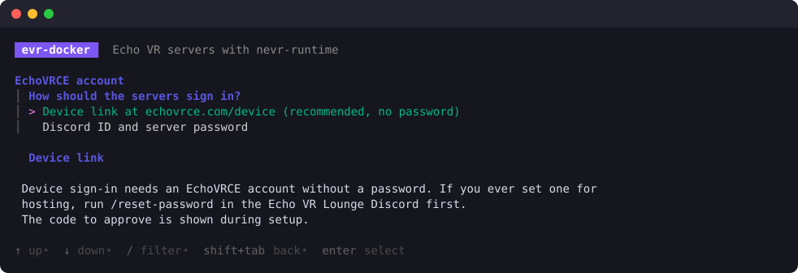
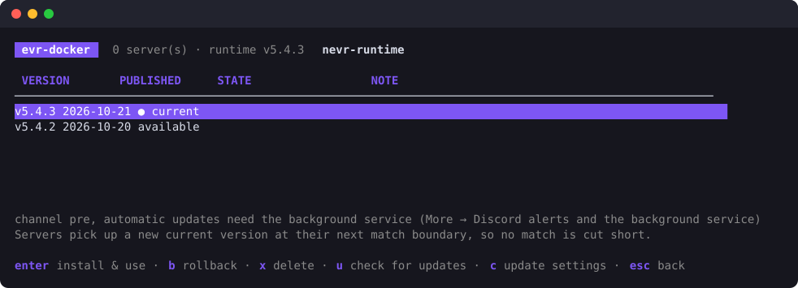
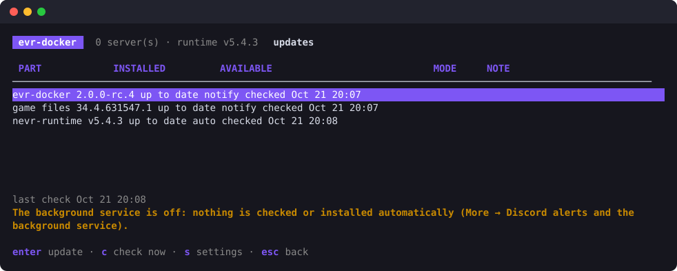

# Echo VR Server on Docker

Run Echo VR dedicated servers with [nevr-runtime](https://github.com/EchoTools/nevr-runtime) on any Linux host with Docker.
`evr-docker` installs and manages them: a guided setup, a live dashboard in the terminal, and a command
for everything the dashboard does.

> Looking for Pterodactyl or Pelican? See [pterodactyl_Echo_Server](https://github.com/marshmallow-mia/pterodactyl_Echo_Server).
> It uses the same image and runtime handling.

## Quick start

On a Debian/Ubuntu host:

```sh
curl -fsSL https://raw.githubusercontent.com/marshmallow-mia/Echo-VR-Server-on-Docker/main/install.sh | sudo sh
```

The installer downloads a checksum-verified `evr-docker` binary of the newest release to `/usr/local/bin` (a
pre-release while there is no stable one; `EVR_VERSION=v2.0.0` picks one), offers to install Docker if it is missing,
and opens the setup wizard. The wizard asks for:

- how the servers sign in to EchoVRCE: a **device link** (you approve a code at echovrce.com/device; no password,
  the Discord ID comes from your account) or your Discord user ID and server password. nevr-runtime 6.x needs the
  password: it refuses a server that has only a device link;
- how many servers to run and their first UDP port (default 6792);
- where the game files come from: the public mirror (about 5 GB), a folder that is already on the host, or an archive.



It then links or checks the account, downloads and verifies the game and the runtime, and starts the servers.
Run `evr-docker` again at any time to open the dashboard.

Updates of `evr-docker` itself, the game files and nevr-runtime are under `U` in the dashboard (see
[Updates](#updates)). Each `evr-docker` version uses the image released with it
(`ghcr.io/marshmallow-mia/echovr-server:<version>`); after an update the servers move to it, each one after its current
match. Set `image:` in `config.yaml` to pin a different one.

Unattended:

```sh
sudo evr-docker init --servers 2 --regions euw      # prints a code to approve at echovrce.com/device
# or with a password:
echo "$PASSWORD" | sudo evr-docker init --discord-id 123456789012345678 --password-stdin \
    --servers 2 --regions euw
# or: sudo evr-docker init --answers answers.yaml   (secrets may be ${ENV} references)
```

## How it works

```
/srv/echovr/
  game/34.4.631547.1/      the game, verified, shared read-only by all servers
  game/current → …
  nevr/v6.6.0/             nevr-runtime (BugSplat64.dll; from 6.0 also nevr-runtime.dll), checksum-verified
  nevr/current → v6.6.0    switched by updates; servers follow at their next match
  instances/<name>/        each server's own files: Wine prefix, config, logs, status.json
/etc/evr-docker/config.yaml  settings (edit by hand or with evr-docker)
/etc/evr-docker/secrets.env  account and webhook (mode 0600)
```

- **One game copy for every server.** Each container mounts it read-only and gets a small writable view of its own (a
  "symlink farm"): its own `_local/config.yaml`, credentials, logs and Wine prefix. From nevr-runtime 6.0 on the
  runtime, `config.yaml`, the sign-in and the logs live in the server's nEVR root instead
  (`.wine/drive_c/users/container/AppData/Local/nevr/echovr`).
- **`evr-supervisor`** runs inside each container and handles the runtime's quirks:
  - It writes the runtime config and the port. nevr-runtime 5.4.2 ignores `-port`, so the port goes into a per-server
    `netconfig_dedicatedserver.json`.
  - For nevr-runtime 6.x it copies the signed `nevr-runtime.dll` and the config into the server's nEVR root before each
    start. 6.x has EchoVRCE's addresses built in, so that config carries only the account and the server's settings, and
    6.x needs the account's password: it refuses a device link alone.
  - It starts the game under Wine and follows its log. It restarts the game after every match, because the runtime
    exits when a match ends.
  - It detects rejected logins, unreachable ports and stuck registrations.
  - It handles the runtime's shutdown hang (nevr-runtime #723): a stop takes about 5 seconds and the server unregisters cleanly.
- **Ports are published 1:1**, and the game port must also be forwarded 1:1 (same number outside and inside). The
  backend registers a server at the address it connects from and the port the game bound; a forwarded port with a
  different number would point players at the wrong place.

The measured runtime behaviour this is built on is documented in [docs/nevr-5.4.2-findings.md](docs/nevr-5.4.2-findings.md)
and, for 6.x, [docs/nevr-6.6.0-findings.md](docs/nevr-6.6.0-findings.md).

## Dashboard

`sudo evr-docker` opens the dashboard: every server with its state, the address it registered as, its runtime version,
and how many matches and restarts it has had.

| Key | Action |
|---|---|
| `enter` | live console (`f` follow, `a` show runtime noise, `/` filter) |
| `s` / `x` | start / stop |
| `r` / `R` | restart only the game (fast) / restart the container |
| `a` / `e` / `d` | add servers / edit one (port, regions, guilds, tick rate, runtime pin, on/off) / delete |
| `A` | apply the configuration (after editing `config.yaml` by hand) |
| `U` | updates of evr-docker, the game files and nevr-runtime: install, pick a version, settings |
| `u` | runtime versions: install (`enter`), roll back (`b`), delete (`x`), check for and roll out an update (`u`), update settings (`c`) |
| `c` | account: sign-in state and registered servers; `l` links this host at echovrce.com/device, `p` signs in with a password |
| `D` | doctor: checks of Docker, disk, game, runtime, account, ports, public IP, with the key that fixes each |
| `g` | install the game files |
| `m` | more: alerts and the background service, number of servers, show or edit the configuration, a compose file, moving a v1 installation |

A failed device link can be retried with `l` right away; a running one can be cancelled with `esc`.



## Commands

Everything in the dashboard is also a command, and every command is also in the dashboard. Add `--json` for scripts and
`-y` to skip confirmations.

```
evr-docker init                       guided setup (or --answers / flags for unattended)
evr-docker doctor                     check everything and print fixes
evr-docker server ls|status NAME      state of the servers
evr-docker server create -n 2 [--regions euw]
evr-docker server edit NAME --tick-rate 90 --regions euw,default [--disable|--enable] [--port N]
evr-docker server start|stop|restart [--soft] NAME|--all
evr-docker server logs NAME [-f]
evr-docker server scale N             keep exactly N servers (removes idle ones from the end)
evr-docker server apply [--force]     make containers match config.yaml
evr-docker server rm NAME [--purge]
evr-docker game install [--from-dir DIR | --archive FILE] / game status
evr-docker runtime ls|install [TAG] [--use]|use TAG|rollback|remove TAG|channel pre|stable|pinned [TAG]
evr-docker account link|set|test|servers   device link (no password) or password sign-in
evr-docker agent install|uninstall|run|webhook URL   metrics, Discord alerts, automatic updates
evr-docker update [check|ls|apply|settings]   evr-docker itself, game files, nevr-runtime
evr-docker migrate detect|run         take over a v1 (bash run.sh) installation
evr-docker export compose             a docker-compose.yml of the same setup
evr-docker config show|edit
```

Changes to a server that is hosting a match are applied after the match (or now with `--force`).

## Updates



`U` in the dashboard lists every part with the installed and the available version. `enter` updates one (you can pick
the version), `c` checks again, `s` sets how each part is updated:

| Part | What an update does | Default |
|---|---|---|
| `evr-docker` | downloads the new release, checks it against `checksums.txt`, replaces the binary (the old one stays as `evr-docker.prev`) and restarts; servers move to the new image after their current match | notify |
| game files | fetches missing or changed files from the mirror and verifies the build; servers use them from their next restart. Echo VR no longer changes, so this is a repair | notify |
| nevr-runtime | installs the version of the runtime channel (`u` screen) and tries it on one idle server first; only if that server registers do the others switch, at their next match boundary. A version that fails is skipped | auto |

Each part is `off`, `notify` (checked; shown in the dashboard and sent as a Discord alert) or `auto` (installed by the
background service), optionally only inside a time window such as `04:00-06:00`. The same with commands:

```
evr-docker update                       check everything
evr-docker update ls self|game|runtime  versions to choose from
evr-docker update apply self|game|runtime [--version V]
evr-docker update settings --self auto --game notify --runtime auto --window 04:00-06:00 --check-hours 6
```

Mods will be one more part here.

## Alerts and metrics

A small background service on the host (dashboard: `m` → Discord alerts and the background service, or
`sudo evr-docker agent install`) runs the update checks above, and:

- **Discord alerts.** Enter a webhook URL in the same dashboard form (or `evr-docker agent webhook https://discord.com/api/webhooks/…`)
  and a test message is sent. You then get
  alerts when a server stops on an error (e.g. a rejected password), keeps restarting, stays down or recovers, and when
  an update is rolled out or rolled back.
- **Prometheus metrics** on `127.0.0.1:9469/metrics`: `evr_server_up`, `evr_server_state`, `evr_server_sessions_total`,
  `evr_server_restarts_total`, `evr_server_registrations_total`, `evr_server_runtime_info`.

## Doing it yourself

Nothing here requires `evr-docker` at run time.

- `m` → Write a docker-compose file (or `evr-docker export compose`) writes a plain compose file. The image `ghcr.io/marshmallow-mia/echovr-server` is
  configured only through environment variables (`evr-supervisor -h` lists them). Mount the game at
  `/opt/echovr/game/current`, nevr-runtime at `/opt/echovr/nevr/<tag>/BugSplat64.dll`, and a writable directory at
  `/home/container`.
- `/etc/evr-docker/config.yaml` can be edited by hand. `evr-docker config edit` validates it, and `server apply` applies it.

## Moving from v1

The old setup (`run.sh`, `install.sh`, cron `echo_update.sh`) is kept on the [`v1`](https://github.com/marshmallow-mia/Echo-VR-Server-on-Docker/tree/v1) branch.

`sudo evr-docker` finds a v1 installation on first start and offers to move it (later: `m` → Move a v1 installation).
The same with commands:

```sh
sudo evr-docker migrate detect
sudo evr-docker migrate run
```

The old servers are replaced, not taken over: evr-docker takes the account from the old `config.json`/`config.yaml`,
imports the game folder (hard-linked, so no second copy), removes the old containers and creates a new server for
each on the same port. The old update cron job is disabled.

Once the new servers run:

- The old logs (`ready-at-dawn-echo-arena/logs/`) are moved to `/srv/echovr/logs/v1/`. You can also keep them where
  they are or delete them.
- You are asked whether to delete the old scripts (`run.sh`, `scripts/`, … and the cron job), the old
  `ready-at-dawn-echo-arena` image and the old game folder. Nothing is deleted unless you pick it and confirm.

`migrate run --logs move|keep|delete` and `--remove scripts,image,game` answer these up front; without `--remove`
it asks for each part, and `--yes` alone deletes nothing.

## Troubleshooting

- The doctor (`D`, or `evr-docker doctor`) checks Docker, LXC settings, disk, the game build, the runtime, the account (and whether it has the
  host role in any guild), port conflicts and the public IP.
- A server in **failed** state shows the reason in the dashboard and in `server status`. Common ones:
  - `bad_credentials`: the backend rejected the Discord ID or password.
  - `udp_unreachable`: the backend could not reach the game port; check the 1:1 port forward.
  - `registration_rejected`: the server did not register in time.
- Under Proxmox LXC, Docker needs `nesting=1,keyctl=1`.

## Building

```sh
go test ./...
go build ./cmd/evr-docker ./cmd/evr-supervisor
docker build -f image/Dockerfile -t echovr-server:dev .
```

`pkg/` holds the shared packages, which the Pterodactyl product also uses: game files, runtime releases, `config.yaml`,
the EchoVRCE account API, the supervisor, status, metrics, alerts, updates and TUI widgets.

## License

GNU General Public License v3.0. Echo VR is property of Meta / Ready At Dawn and is not included; nevr-runtime is
Apache-2.0 by EchoTools.
